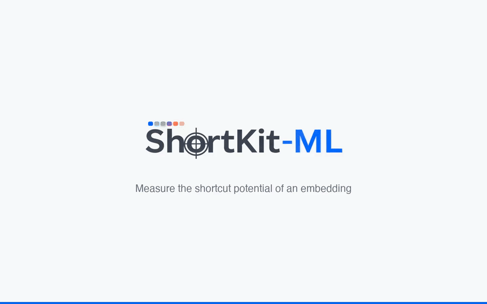

<p align="center">
  
</p>

<p align="center">One calibrated test of whether an embedding carries a sensitive attribute beyond what the task label explains. Any encoder, any modality, your own data, on your own machine.</p>

[](https://pypi.org/project/shortkit-ml/)
[](https://github.com/criticaldata/ShortKit-ML/actions/workflows/tests.yml)
[](https://criticaldata.github.io/ShortKit-ML/)
[](https://www.medrxiv.org/content/10.64898/2026.04.29.26352053v1)
[](https://huggingface.co/datasets/MITCriticalData/ShortKit-ML-data)

<p align="center">
  <a href="https://criticaldata.github.io/ShortKit-ML/getting-started/walkthrough/"></a>
  <br/><sub>Any embedding, on your own machine: load your files, run the audit, read the verdict and the figures, download the PDF. The full walkthrough video is on the <a href="https://criticaldata.github.io/ShortKit-ML/getting-started/walkthrough/">walkthrough page</a>.</sub>
</p>

## What it does

- **Any embedding, any modality.** The package only sees a float matrix `(n_samples, embedding_dim)`, one attribute array and one task-label array. Image, text, audio, tabular and multimodal encoders of any width go in the same way.
- **Runs locally.** Nothing leaves the machine: no account, no upload. The dashboard binds to 127.0.0.1 and the MCP server speaks stdio.
- **One calibrated test.** A conditional probe (L2 logistic regression predicting the attribute from the embedding and the task label, out-of-fold AUROC) against a permutation null that shuffles the attribute within task-label strata. Five secondary detectors describe; the probe decides at p < 0.05. The result is written as an HTML or PDF report.
- **A dashboard.** `python app.py` runs the same audit with a mouse, sample data included.
- **An MCP server.** Agents (Claude Code, Claude Desktop, GitHub Copilot, DOJO-style evaluation platforms) call the audit on files and get back the result, the summary and the report.
- **Your data, your detectors.** Nothing is tied to chest X-rays: the same call audits any embedding you can load. New detectors subclass `DetectorBase` (template in `shortcut_detect/detector_template.py`) and run under the same permutation null; contributions are welcome, see [docs/contributing.md](docs/contributing.md).

## Install

```bash
pip install shortkit-ml          # Python 3.10 to 3.12
```

From source, for the examples, the dashboard and the walkthrough data:

```bash
git clone https://github.com/criticaldata/ShortKit-ML.git && cd ShortKit-ML
uv venv --python 3.10 && source .venv/bin/activate   # Windows: .venv\Scripts\activate
uv pip install -e .        # or: pip install -e .
```

`pip install "shortkit-ml[all]"` (or `uv pip install -e ".[all]"` from source) adds the MCP server, Hugging Face models, Jupyter and dev tools; PDF export needs Pango, see [Installation](docs/getting-started/installation.md).

## Audit your embeddings

```python
import numpy as np
from shortcut_detect.audit import AuditConfig, conditional_audit
from shortcut_detect.audit.report import audit_report, summary_text

E = np.load("embeddings.npy")   # (n_samples, embedding_dim), any width
A = np.load("attribute.npy")    # (n_samples,) e.g. sex
Y = np.load("task.npy")         # (n_samples,) task label

result = conditional_audit(E, A, Y, config=AuditConfig(n_permutations=200, n_permutations_probe=500, seed=42))
probe = result.results["probe"]  # the primary test
print(probe.statistic, probe.ci_low, probe.ci_high, probe.p_value, probe.flag)
print(summary_text(result, attribute="sex", task="pneumothorax"))
audit_report(result, "audit.pdf", title="ViT-B/16 audit", attribute="sex", task="pneumothorax")  # or audit.html
```

With several rows per patient, pass `groups=patient_ids`: folds become patient-disjoint and the null permutes at patient level.

## Dashboard

The same audit with a mouse, served at http://127.0.0.1:7860 (or the next free port); guide in [docs/getting-started/dashboard.md](docs/getting-started/dashboard.md).

```bash
python app.py
```

## MCP server

```bash
uv pip install -e ".[mcp]"
claude mcp add --scope project shortkit-ml .venv/bin/python -- -m shortcut_detect.mcp_server
```

`run_audit` reads E, A, Y and optional patient ids from files, runs `conditional_audit` and returns the result as JSON, writing the HTML or PDF report where you ask. Setup for Claude Desktop and GitHub Copilot in VS Code, the other tools and troubleshooting: [docs/mcp-server.md](docs/mcp-server.md).

## Reproducing the paper

Every table and figure of the [ShortKit-ML paper](https://doi.org/10.64898/2026.04.29.26352053) comes from one pipeline: `./scripts/reproduce_paper.sh revision`.

It reads the paper's embeddings from the gated dataset [MITCriticalData/ShortKit-ML-data](https://huggingface.co/datasets/MITCriticalData/ShortKit-ML-data) (`hf download MITCriticalData/ShortKit-ML-data --repo-type dataset --local-dir data/`), shared only with users who hold PhysioNet access to MIMIC-CXR: request access on the dataset page and include your PhysioNet username; proof of MIMIC-CXR access is required before approval.

Stages, output folders and the CheXpert files that come from Stanford: [docs/reproducibility.md](docs/reproducibility.md).

## Other package methods

`ShortcutDetector` runs 19 exploratory detectors against fixed thresholds, with six mitigation methods beside them, all documented on the site ([methods overview](docs/methods/overview.md)); their risk labels are for exploration and are not the paper's result.

## Documentation

Site: [criticaldata.github.io/ShortKit-ML](https://criticaldata.github.io/ShortKit-ML/), starting with the [walkthrough](docs/getting-started/walkthrough.md). Tests: `pytest tests/ -v`. Contributing: [docs/contributing.md](docs/contributing.md).

## Cite

If you use ShortKit-ML, cite the ShortKit-ML paper ([preprint](https://doi.org/10.64898/2026.04.29.26352053)):

```bibtex
@article{cajas2026shortkit,
  title={ShortKit-ML: an open toolkit for measuring shortcut potential in medical imaging embeddings},
  author={Cajas, Sebastian and Marzullo, Aldo and Kapadia, Sahil and Santos, Filipe and Ocampo Osorio, Felipe and Kong, Qingpeng and Quarta, Alessandro and Kuo, Po-Chih and Patel, Milit and Rojas Sillery, Raul Ignacio and Celi, Leo Anthony},
  journal={medRxiv},
  year={2026},
  doi={10.64898/2026.04.29.26352053},
  url={https://www.medrxiv.org/content/10.64898/2026.04.29.26352053v1}
}
```

## License

MIT License, see [LICENSE](LICENSE).

## Contact

- **GitHub**: [criticaldata/ShortKit-ML](https://github.com/criticaldata/ShortKit-ML)
- **Issues**: [GitHub Issues](https://github.com/criticaldata/ShortKit-ML/issues)
