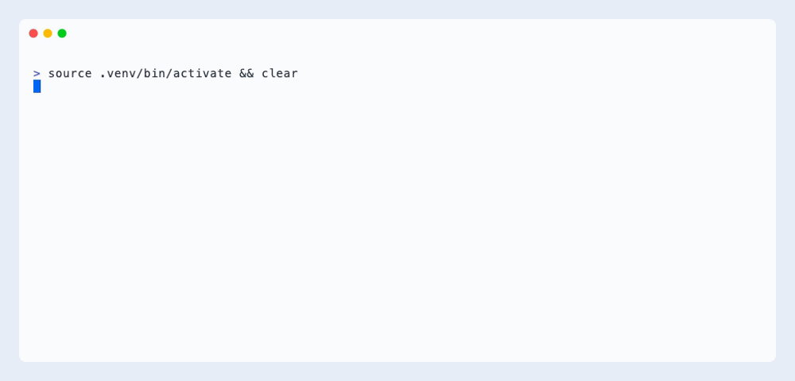
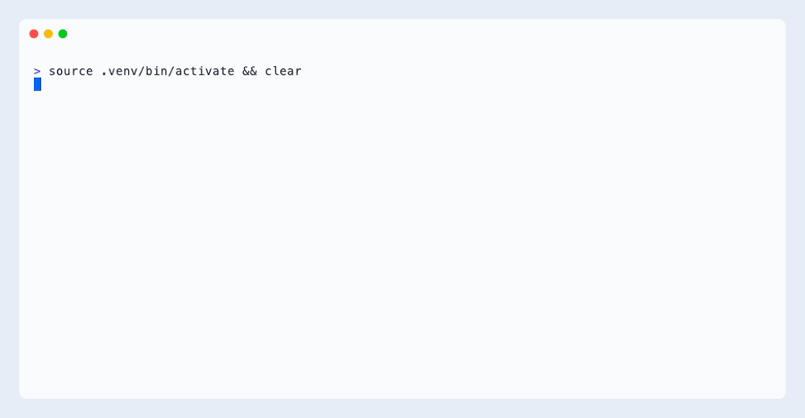
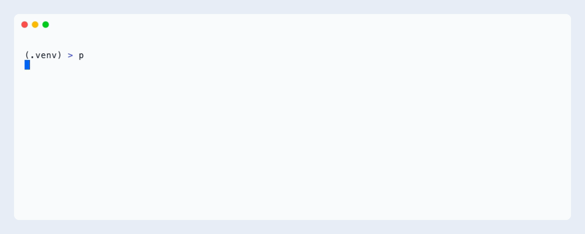

# Walkthrough: audit an embedding, step by step

This page is the whole workflow of the [ShortKit-ML paper](https://doi.org/10.64898/2026.04.29.26352053)'s audit on one public data set, CelebA ResNet-50 embeddings, from a fresh install to the PDF report. Every recording below is a real terminal session (tap one to open it full size on a phone); the scripts it runs are in [`examples/walkthrough/`](https://github.com/criticaldata/ShortKit-ML/tree/main/examples/walkthrough), so you can replay each step on your own data by changing one path.

The question the audit answers: **does an embedding carry a sensitive attribute beyond what the task label explains?** If it does, a classifier trained on that embedding could take a shortcut through the attribute. The audit measures this *shortcut potential* with one calibrated test; whether a particular classifier uses it is a separate experiment.

## 1. Install

`pip install shortkit-ml` gives you the package; the clone below adds the examples and the sample data. About ten seconds with `uv` when the wheels are cached; `pip install -e .` works the same way.

```bash
git clone https://github.com/criticaldata/ShortKit-ML.git && cd ShortKit-ML
uv venv .venv && source .venv/bin/activate
uv pip install -e .
```

## 2. What the audit needs

Four arrays, three of them required:

| Array | Shape | Meaning |
|---|---|---|
| `E` | `(n, d)` float | one embedding per row, from any encoder, any width `d` |
| `A` | `(n,)` | the sensitive attribute (sex, age group, race, site, scanner) |
| `Y` | `(n,)` | the task label the classifier would learn |
| `groups` | `(n,)`, optional | a unit id (patient, identity) when one unit has several rows |

`A` and `Y` are usually correlated in clinical data, so a plain probe for `A` would partly read `Y`. The audit conditions on `Y` and asks the sharper question.

[](../assets/walkthrough/02-data.gif "Open full size")

```python
E = np.load("data/celeba/celeba_real_embeddings.npy")       # (10000, 2048)
att = pd.read_csv("data/celeba/celeba_real_attributes.csv")  # same row order
A = att["Male"].to_numpy()
Y = att["Blond_Hair"].to_numpy()
```

## 3. Any file, any encoder, any modality

The audit sees only the matrix. Embeddings saved as `.npy`, `.csv`, `.parquet` or a torch tensor all load to the same `(n, d)` array, and the width is whatever your encoder produced: 384 from a sentence model, 8 from a tabular model, 2048 from ResNet-50.

[{ loading=lazy }](../assets/walkthrough/03-formats.gif "Open full size")

The only rules: `E` is 2-D float with finite values; `A`, `Y` and `groups` have one entry per row of `E`, in the same order.

## 4. Run the audit

`conditional_audit` fits the primary test, a logistic probe predicting `A` from `[E, Y]`, scores it by out-of-fold AUROC, and calibrates it by permuting `A` within levels of `Y` (between patients when `groups` is given). Five secondary detectors share that null and are reported as diagnostics. Default budget as in the paper: 500 permutations for the probe, 200 for the rest; about 40 s for 2,000 images of width 2,048 on a laptop CPU.

[{ loading=lazy }](../assets/walkthrough/04-audit.gif "Open full size")

```python
from shortcut_detect.audit import AuditConfig, conditional_audit

cfg = AuditConfig(n_permutations=200, n_permutations_probe=500, seed=42)
result = conditional_audit(E, A, Y, config=cfg)          # groups=patient_ids when needed
probe = result.results["probe"]
print(probe.statistic, probe.ci_low, probe.ci_high, probe.p_value, probe.flag)
```

How to read it: the probe AUROC is the score; the null mean is what that score looks like when `A` carries no information beyond `Y`; the permutation `p` says whether the observed score is unusual under that null. The probe decides at `p < 0.05`. The secondary detectors are flagged at Benjamini-Hochberg `q < 0.05` across the five and describe the signal; they never change the decision.

## 5. Why conditioning matters

On data where `A` follows `Y` ninety per cent of the time but the embedding encodes only `Y`, an unconditional probe fires (it reads `A` through `Y`), while the conditional audit stays at its null. Plant an `A` signal and the conditional audit fires.

[{ loading=lazy }](../assets/walkthrough/05-calibration.gif "Open full size")

Under a true null the conditional probe rejected 2 to 3 per cent of synthetic data sets in the paper; the unconditional probe rejected 95 per cent at the same correlation.

## 6. The report

`audit_report` writes the same audit as a self-contained HTML page or a two-page PDF: the setting, a plain-language verdict, the detector table against the null, and one panel per detector.

[{ loading=lazy }](../assets/walkthrough/06-report.gif "Open full size")

```python
from shortcut_detect.audit.report import audit_report

audit_report(result, "celeba_audit.html", attribute="Male", task="Blond_Hair")
audit_report(result, "celeba_audit.pdf", attribute="Male", task="Blond_Hair")
```

## 7. The same audit in the dashboard

The tour in one video: install, bring your embeddings (any encoder, any modality), then the dashboard's Audit tab from a clean terminal (`python app.py`, the CelebA sample, the run, the verdict and the table, the PDF downloaded and read to the end), and the MCP call for agents.

<video autoplay muted loop playsinline controls preload="metadata" style="width:100%;border-radius:8px" poster="../../assets/walkthrough/dashboard-audit-poster.jpg" src="../../assets/walkthrough/dashboard-audit.mp4"></video>

```bash
python app.py        # opens http://127.0.0.1:7860, Audit tab first
```
