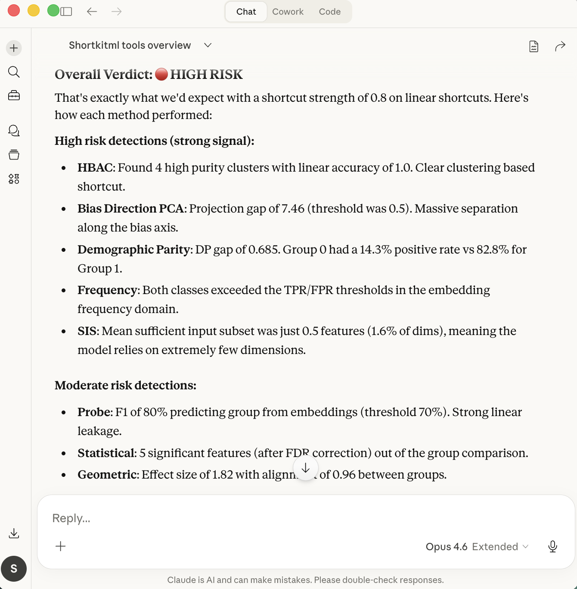

# MCP Server

ShortKit-ML ships a [Model Context Protocol](https://modelcontextprotocol.io/) server, `shortcut_detect.mcp_server`, that speaks MCP over stdio. An assistant connected to it (Claude Code, Claude Desktop, GitHub Copilot in VS Code, or any other MCP client) can run the audit on files you name in chat, with no Python script.

The server registers nine tools. `run_audit` is the audit of the paper, `shortcut_detect.audit.conditional_audit`: one conditional probe calibrated by a permutation null, which decides at p < 0.05, plus five secondary detectors that are descriptive. The other eight tools wrap the older `ShortcutDetector` pipeline (19 methods, fixed thresholds, risk-level verdicts). The paper withdrew those verdicts; the tools stay for exploration and are described in [the last section](#exploratory-tools-the-legacy-pipeline).

## Install and check

```bash
uv pip install -e ".[mcp]"
.venv/bin/python -m shortcut_detect.mcp_server
```

The second command starts the server and waits for a client on stdin, so it prints nothing. Press `Ctrl+C` to stop it. `shortkit-ml-mcp` is the same entry point installed as a console script.

## The run_audit tool

`run_audit` reads the four arrays of the audit from files and returns one JSON object. It never takes inline arrays: embeddings are too large for a chat message, and a file path is what an agent can pass without copying data through the model.

| Argument | Required | Meaning |
|----------|----------|---------|
| `embeddings_path` | yes | E, an `(n, d)` matrix. `.npy`, `.npz` with one array, `.csv`, `.tsv` or `.txt` |
| `attribute_path` | yes | A, one value per row, strings or integers (`sex`, `0/1`, `site`) |
| `task_path` | yes | Y, one value per row, strings or integers; the audit conditions on it |
| `groups_path` | no | patient ids, one per row; makes folds, bootstrap and permutations patient-level |
| `n_permutations` | no | K for the five secondary detectors, default 200 |
| `n_permutations_probe` | no | K for the probe; defaults to `n_permutations`. The paper's clinical audits used 500 |
| `seed` | no | default 0 |
| `attribute`, `task` | no | names used in the summary and the report, for example `sex` and `pneumothorax` |
| `report_path` | no | `.html` or `.pdf`; written with `shortcut_detect.audit.report.audit_report` |

A CSV label file may carry a header row. A file of string labels must have one, because its first row is read as the header. The task label is encoded to integer codes in sorted order of its levels; `task_levels` in the output gives that order. Both A and Y need at least two levels.

### Worked call

In chat, you write something like this:

```text
Run the ShortKit-ML audit on /data/cxr/E.npy with attribute /data/cxr/sex.csv and
task /data/cxr/pneumothorax.csv. Call them sex and pneumothorax, use 500 probe
permutations and 200 for the rest, and write the report to /data/cxr/audit.pdf.
```

The assistant then calls the tool with these arguments:

```json
{
  "embeddings_path": "/data/cxr/E.npy",
  "attribute_path": "/data/cxr/sex.csv",
  "task_path": "/data/cxr/pneumothorax.csv",
  "attribute": "sex",
  "task": "pneumothorax",
  "n_permutations": 200,
  "n_permutations_probe": 500,
  "seed": 0,
  "report_path": "/data/cxr/audit.pdf"
}
```

The same call from Python, which is what the test suite exercises:

```python
from shortcut_detect.mcp_server import run_audit

print(run_audit(
    embeddings_path="/data/cxr/E.npy",
    attribute_path="/data/cxr/sex.csv",
    task_path="/data/cxr/pneumothorax.csv",
    attribute="sex", task="pneumothorax",
    n_permutations=200, n_permutations_probe=500,
    report_path="/data/cxr/audit.pdf",
))
```

Abridged output (synthetic data, 300 rows, 16 dimensions, K = 20, where the attribute was planted in one dimension):

```json
{
  "attribute": "sex",
  "task": "pneumothorax",
  "n": 300,
  "n_groups": 2,
  "attribute_levels": ["female", "male"],
  "task_levels": ["0", "1"],
  "group_sizes": {"Y=0,A=female": 64, "Y=0,A=male": 82, "Y=1,A=female": 84, "Y=1,A=male": 70},
  "probe": {
    "statistic": 0.817,
    "ci_low": 0.768,
    "ci_high": 0.858,
    "null_mean": 0.514,
    "null_sd": 0.049,
    "p_value": 0.048,
    "flag": true,
    "n_permutations": 20
  },
  "detectors": [
    {"detector": "probe", "statistic": 0.817, "p_value": 0.048, "flag": true, "...": "..."},
    {"detector": "statistical", "...": "..."},
    {"detector": "geometric", "...": "..."},
    {"detector": "bias_direction", "...": "..."},
    {"detector": "hbac_nmi", "...": "..."},
    {"detector": "frequency_topk", "...": "..."}
  ],
  "n_flagged": 6,
  "summary": "The conditional probe predicts sex from the embedding and pneumothorax; its out-of-fold AUROC is 0.817 (95% CI 0.768 to 0.858) against a permutation null of 0.514 (SD 0.049, 20 permutations of sex within levels of pneumothorax), p = 0.048. At alpha = 0.05 the embedding carries information about sex beyond what pneumothorax explains ...",
  "report_path": "/data/cxr/audit.pdf"
}
```

`probe` is the decision: out-of-fold AUROC of the conditional probe, its bootstrap 95% interval, the mean and SD of the permutation null, the permutation p-value and the flag (p below 0.05). `detectors` holds the six rows of `AuditResult.rows()`, one per detector, with the same statistics plus the Benjamini-Hochberg q (`p_bh`) for the five secondaries, the run time in seconds, and the fold strata and attribute level used. `n_flagged` counts flagged rows across all six and is descriptive. `summary` is the paragraph of `summary_text`, the same text that heads the report. Quantities that do not exist for a detector (the statistical detector has no CI, the probe has no q) come back as `null`.

Twenty permutations on 300 rows of 16 dimensions take a few seconds on a laptop; the cost grows about linearly with K and with n.

## Register the server

Every client runs the same command, `.venv/bin/python -m shortcut_detect.mcp_server`, from the repo root. Use the interpreter inside `.venv`: a bare `python` or `uv run` resolves to a different interpreter in Claude Desktop, where `shortcut_detect` is not installed.

### Claude Code

The repo ships `.mcp.json`, so a Claude Code session opened from the repo root already sees the server. On first use Claude Code asks you to approve the project server; until then `claude mcp list` shows it as `Pending approval (run claude to approve)`.

To register it yourself, or in another checkout:

```bash
claude mcp add --scope project shortkit-ml .venv/bin/python -- -m shortcut_detect.mcp_server
```

This writes `.mcp.json`:

```json
{
  "mcpServers": {
    "shortkit-ml": {
      "type": "stdio",
      "command": ".venv/bin/python",
      "args": ["-m", "shortcut_detect.mcp_server"],
      "env": {}
    }
  }
}
```

Check with `claude mcp list`. Once approved the line reads:

```text
shortkit-ml: .venv/bin/python -m shortcut_detect.mcp_server - ✓ Connected
```

### Claude Desktop (macOS)

Claude Desktop does not inherit your shell `PATH`, so the command needs the absolute path of the interpreter. Find it with `echo $(pwd)/.venv/bin/python` from the repo root, then add the block to `~/Library/Application Support/Claude/claude_desktop_config.json`:

```json
{
  "mcpServers": {
    "shortkit-ml": {
      "command": "/Users/yourname/ShortKit-ML/.venv/bin/python",
      "args": ["-m", "shortcut_detect.mcp_server"],
      "cwd": "/Users/yourname/ShortKit-ML"
    }
  }
}
```

Replace `/Users/yourname/ShortKit-ML` with your checkout. Restart Claude Desktop; the `shortkit-ml` tools then appear in the tools panel.

| Error | Cause | Fix |
|-------|-------|-----|
| `Server disconnected` | bare `uv` or `python` used as command | use the full `.venv/bin/python` path |
| `ModuleNotFoundError: No module named 'mcp'` | `mcp` not installed in `.venv` | `uv pip install -e ".[mcp]"` |
| `ModuleNotFoundError: No module named 'shortcut_detect'` | `uv run` used as command; it picks its own managed Python | use `.venv/bin/python` directly |

### GitHub Copilot in VS Code

The repo ships `.vscode/mcp.json`, read by Copilot Chat in Agent mode when the repo root is the open workspace:

```json
{
  "servers": {
    "shortkit-ml": {
      "type": "stdio",
      "command": ".venv/bin/python",
      "args": ["-m", "shortcut_detect.mcp_server"]
    }
  }
}
```

Open Copilot Chat, switch the mode dropdown to Agent, and open the tools list; the `shortkit-ml` server and its tools should be there. If VS Code cannot find the interpreter, replace `command` with the absolute path of your `.venv/bin/python`. The config and its test (`tests/test_copilot_mcp_config.py`) are in place; the Copilot Chat smoke test itself still needs a confirmation in VS Code by running a real prompt.

## Agent environments

The paper's conclusion names DOJO (Distributed Open Justice Oversight, Xiang et al. 2026), a community-driven platform for adversarial evaluation of health AI, as a setting where the audit would run as one of the embedding-level checks. The MCP server is the hook for that kind of environment: an agent holding an embedding matrix, an attribute, a task label and optional patient ids calls `run_audit` over MCP with the same four arrays, as files, and gets back the calibrated result, the summary and the report that the Python API gives.

## Exploratory tools (the legacy pipeline)

The remaining eight tools run the first-submission `ShortcutDetector` pipeline: 19 methods, each with a fixed threshold and a low, moderate or high risk level, combined by majority vote. The paper withdrew those verdicts in favour of the calibrated audit above, so treat these tools as a way to look at individual method statistics, not as a decision. Each tool's description in the server says so.

| Tool | What it does |
|------|--------------|
| `list_methods` | the 19 methods with one-line descriptions |
| `generate_synthetic_data` | a synthetic dataset (linear, nonlinear or none, configurable strength) as inline arrays |
| `run_detector` | runs chosen methods on embeddings; returns a verdict, a risk level and a per-method breakdown |
| `get_summary` | the text summary of a previous `run_detector` session |
| `get_method_detail` | the raw result dict of one method from a session |
| `compare_methods` | side-by-side table and majority vote across methods |
| `generate_report` | HTML, PDF or Markdown report of a session, optionally base64-encoded |
| `run_benchmark` | the synthetic benchmark grid through `BenchmarkRunner` |

`run_detector` and `compare_methods` take embeddings, labels and group labels inline or as file paths (`embeddings_path`, `labels_path`, `group_labels_path`; same formats as `run_audit`). Labels are cast to integers. Default methods are `hbac`, `probe` and `statistical` for `run_detector` and those plus `geometric` and `demographic_parity` for `compare_methods`.

Prompts that reach these tools:

```text
List the ShortKit-ML detection methods.
Generate 200 synthetic samples with a linear shortcut (strength 0.8) and run probe, statistical and hbac on them.
Run the detector on my embeddings at ~/data/embeddings.npy with labels at ~/data/labels.npy and group labels at ~/data/group_labels.npy.
Compare all default methods on 300 nonlinear shortcut samples. Which ones agree?
Show me the raw results for hbac from the last run.
Generate an HTML report for the last detector run and give me the file path.
Run the ShortKit-ML synthetic benchmark and show me the results.
```

Sessions of `run_detector` are cached under `~/.cache/shortkit-ml-mcp/` with `joblib` and survive a server restart; pass `session_id` to name one and `get_summary`, `get_method_detail` and `generate_report` read it back. Each MCP client gets its own sessions. `run_audit` keeps no session: its result is the JSON it returns and the report it writes.



*Claude Desktop running the 19 legacy methods on a synthetic dataset through `run_detector`. The HIGH RISK verdict shown is the legacy pipeline's majority vote, not the audit's decision.*
