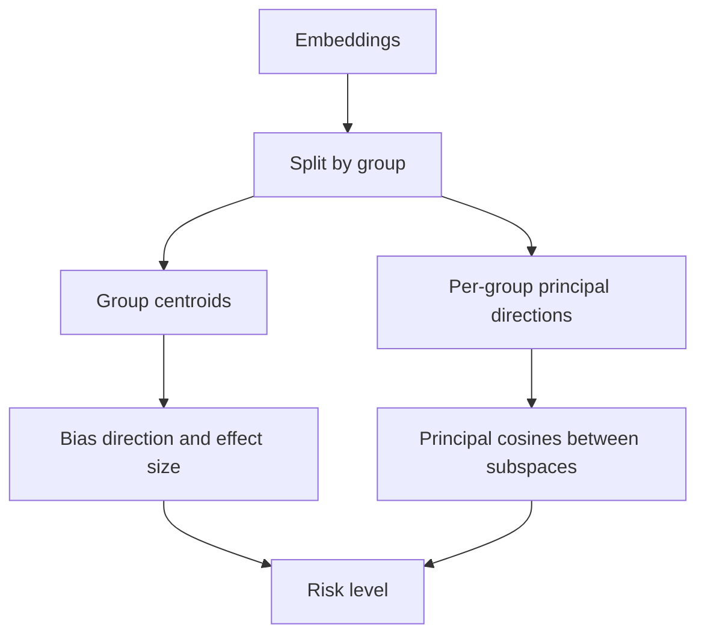

# Geometric analysis

**Geometric analysis** compares the groups' positions and shapes in embedding space: how far apart their centroids sit, and how much their principal subspaces overlap.

## How it works

For every pair of groups with at least `min_group_size` rows, `GeometricShortcutAnalyzer`:

1. **Computes centroids** and the unit vector between them (the bias direction)
2. **Projects** all embeddings onto that direction and measures the standardised gap between the two groups' mean projections (the effect size, a Cohen's d)
3. **Fits** the top `n_components` principal directions of each group and measures the principal cosines between the two subspaces
4. **Flags** a pair when its effect size is at or above `effect_threshold`, or its mean principal cosine is at or above `subspace_cosine_threshold`



## Basic usage

```python
from shortcut_detect import GeometricShortcutAnalyzer

analyzer = GeometricShortcutAnalyzer(n_components=5)
analyzer.fit(embeddings, group_labels)

print(analyzer.summary_)           # risk_level, message, num_high_effect_pairs, num_overlap_pairs
pair = analyzer.bias_pairs_[0]     # sorted by effect size, largest first
print(f"{pair.groups}: effect size {pair.effect_size:.2f}, gap {pair.projection_gap:.2f}")
sub = analyzer.subspace_pairs_[0]  # sorted by mean cosine, largest first
print(f"{sub.groups}: mean cosine {sub.mean_cosine:.2f}, smallest angle {sub.min_angle_deg:.1f} degrees")
```

## Parameters

| Parameter | Type | Default | Description |
|-----------|------|---------|-------------|
| `n_components` | int | 5 | Principal directions kept per group |
| `min_group_size` | int | 20 | Groups with fewer rows are skipped |
| `effect_threshold` | float | 0.8 | Effect size at or above which a centroid pair counts as a signal |
| `subspace_cosine_threshold` | float | 0.85 | Mean principal cosine at or above which a subspace pair counts as a signal |

## Outputs

### Attributes

| Attribute | Type | Description |
|-----------|------|-------------|
| `group_stats_` | dict | Per group, keyed by its label as a string: `count`, `centroid`, `components` (`n_components` by `embedding_dim`), `variance_fraction`, `mask`, `projection_std` |
| `bias_pairs_` | list of `BiasPairStats` | Per pair: `groups`, `direction_norm`, `effect_size`, `projection_gap`, `alignment_score`; sorted by effect size |
| `subspace_pairs_` | list of `SubspacePairStats` | Per pair: `groups`, `mean_cosine`, `min_angle_deg`, `max_angle_deg`; sorted by mean cosine |
| `summary_` | dict | `risk_level`, `message`, `num_high_effect_pairs`, `num_overlap_pairs` |
| `shortcut_detected_` | bool | True at moderate or high risk |

### Interpretation

| Risk | Rule |
|------|------|
| high | at least one pair over the effect threshold and at least one over the cosine threshold |
| moderate | one of the two |
| low | neither |

A large effect size means the groups sit apart along the line between their centroids. A high mean cosine means the groups' principal subspaces point the same way; the analyzer counts that as a second signal, on the reasoning that a shared dominant direction can carry the group. Both thresholds are fixed heuristics. The paper's audit calibrates a geometric statistic (centroid distance over within-group spread, within task strata) against a permutation null instead; see the [Audit API](../api/audit.md).

## Bias direction analysis

The bias direction between two groups is the unit vector between their centroids. `group_stats_` holds the centroids, so the direction and the projections are a few lines of NumPy:

```python
import numpy as np
import matplotlib.pyplot as plt

g0, g1 = analyzer.bias_pairs_[0].groups
c0, c1 = analyzer.group_stats_[g0]["centroid"], analyzer.group_stats_[g1]["centroid"]
direction = (c1 - c0) / np.linalg.norm(c1 - c0)
projections = embeddings @ direction

fig, ax = plt.subplots(figsize=(10, 4))
for group in (g0, g1):
    mask = analyzer.group_stats_[group]["mask"]
    ax.hist(projections[mask], bins=50, alpha=0.5, label=f"group {group}")
ax.set_xlabel("projection onto the bias direction")
ax.set_ylabel("count")
ax.legend()
plt.title(f"effect size {analyzer.bias_pairs_[0].effect_size:.2f}")
plt.tight_layout()
plt.savefig("bias_direction.png")
```

## Subspace analysis

```python
g0, g1 = analyzer.subspace_pairs_[0].groups
U0 = analyzer.group_stats_[g0]["components"]   # (n_components, embedding_dim)
U1 = analyzer.group_stats_[g1]["components"]
print(f"variance kept: {analyzer.group_stats_[g0]['variance_fraction']:.2f}, "
      f"{analyzer.group_stats_[g1]['variance_fraction']:.2f}")
print(f"mean principal cosine: {analyzer.subspace_pairs_[0].mean_cosine:.2f}")
```

The principal cosines are the singular values of $U_0 U_1^T$ after orthonormalising both bases; `min_angle_deg` and `max_angle_deg` are the matching angles.

## Several groups

`fit` accepts any number of groups; `bias_pairs_` and `subspace_pairs_` hold every pair:

```python
for pair in analyzer.bias_pairs_:
    print(f"{pair.groups[0]} vs {pair.groups[1]}: effect size {pair.effect_size:.2f}")
```

## Removing the bias direction

Projecting the bias direction out of the embeddings is one step of linear debiasing. The analyzer has no method for it; with the `direction` computed above it is one line:

```python
embeddings_debiased = embeddings - np.outer(embeddings @ direction, direction)

analyzer_after = GeometricShortcutAnalyzer()
analyzer_after.fit(embeddings_debiased, group_labels)
print(analyzer_after.summary_)
print(analyzer_after.bias_pairs_)   # [] when the two centroids now coincide
```

With two groups the projection makes the centroids coincide, so the analyzer drops that pair (`bias_pairs_` is empty) and the risk level rests on the subspace test alone. The probe is the better check of what the projection removed; see [Linear debiasing](../examples/advanced.md#linear-debiasing).

## Example with synthetic data

```python
from shortcut_detect import GeometricShortcutAnalyzer, generate_linear_shortcut

X, group = generate_linear_shortcut(n_samples=1000, embedding_dim=100, shortcut_dims=5, seed=42)

analyzer = GeometricShortcutAnalyzer(n_components=5)
analyzer.fit(X, group)
print(analyzer.summary_["risk_level"], f"{analyzer.bias_pairs_[0].effect_size:.2f}")
```

With five planted dimensions the centroid pair is far over the effect threshold, while the two groups' principal subspaces are not aligned, so the risk level is `moderate` (one signal of two).

## When to use geometric analysis

**Use geometric analysis when:**

- You want to see the geometric structure of the bias
- You plan to apply linear debiasing
- You need an interpretable bias direction
- Groups may occupy different subspaces

**Don't use geometric analysis when:**

- Biases are highly non-linear
- You have very few samples per group (< 30)
- Embeddings are very high-dimensional relative to samples

## Theory

### Bias direction

$$\mathbf{d} = \frac{\mu_1 - \mu_0}{||\mu_1 - \mu_0||}$$

where $\mu_g$ is the centroid of group $g$.

### Effect size

Cohen's d along the bias direction:

$$d = \frac{|\bar{p}_1 - \bar{p}_0|}{s_{\text{pooled}}}$$

where $\bar{p}_g$ is the mean projection of group $g$ onto the bias direction and $s_{\text{pooled}}$ the pooled standard deviation of the projections.

### Subspace overlap

With $U_0$ and $U_1$ the orthonormalised principal bases of the two groups, the principal cosines are the singular values $\sigma_i$ of $U_0^T U_1$ and the overlap score is their mean:

$$\text{overlap} = \frac{1}{k} \sum_{i=1}^{k} \sigma_i$$

A pair counts as a signal when this mean is at or above `subspace_cosine_threshold`.

## See also

- [HBAC clustering](hbac.md): clustering-based detection
- [API reference](../api/geometric.md): full API documentation
- [Overview](overview.md): compare all methods
