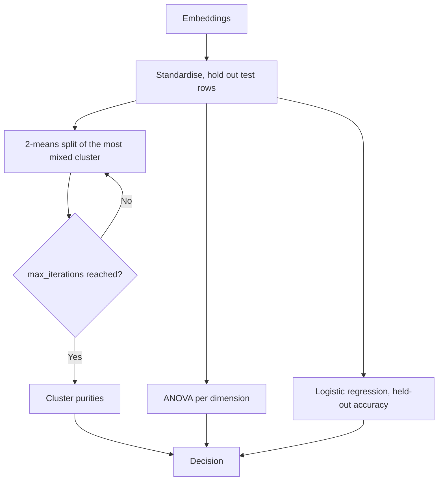

# HBAC clustering

**Hierarchical Bias-Aware Clustering** checks whether the embeddings split into clusters that are nearly pure in the group label, and whether a linear classifier separates the groups. Both are signs that the group is easy to read off the embedding.

## How it works

`HBACDetector` (an alias of `EmbeddingShortcutDetector`) standardises the embeddings, holds out `test_size` of the rows, and then:

1. **Splits** the training rows with 2-means, up to `max_iterations` times, each time splitting the cluster whose labels vary most; sub-clusters smaller than `min_cluster_size` of the training rows are dropped
2. **Scores purity** per cluster: the share of its rows that carry the dominant label
3. **Ranks dimensions** with a one-way ANOVA of each dimension against the label
4. **Tests linearity** with a logistic regression fitted on the training rows and scored on the held-out rows
5. **Decides**: shortcut if two or more clusters have purity above 0.8, or if fewer than 10% of the dimensions are significant (p < 0.01) and the held-out linear accuracy is above 0.85



## Basic usage

```python
from shortcut_detect import HBACDetector

detector = HBACDetector(
    max_iterations=3,       # number of 2-means splits
    min_cluster_size=0.05,  # smallest cluster kept, as a fraction of the training rows
    random_state=42,
)
detector.fit(embeddings, group_labels)

verdict = detector.shortcut_report_["has_shortcut"]
print(f"Shortcut detected: {detector.shortcut_detected_} ({verdict['confidence']} confidence)")
print(f"Signals: {verdict['types']}")
print(f"Linear test accuracy: {detector.shortcut_report_['linearity_score']['test_accuracy']:.2f}")
for cluster in detector.shortcut_report_["cluster_purities"]:
    print(f"cluster {cluster['cluster_id']}: {cluster['size']} rows, purity {cluster['purity']:.2f}")
```

## Parameters

| Parameter | Type | Default | Description |
|-----------|------|---------|-------------|
| `max_iterations` | int | 3 | Number of 2-means splits |
| `min_cluster_size` | float | 0.01 | Smallest cluster kept, as a fraction of the training rows |
| `test_size` | float | 0.2 | Share of rows held out for the linearity test |
| `random_state` | int | 42 | Seed for the split and for k-means |
| `config` | `HBACConfig` | None | Frozen dataclass with the same four fields; takes precedence when given |

## Outputs

### Attributes

| Attribute | Type | Description |
|-----------|------|-------------|
| `shortcut_detected_` | bool | Whether the decision rule fired |
| `shortcut_report_` | dict | `cluster_purities` (one dict per cluster: `cluster_id`, `size`, `purity`, `dominant_label`), `dimension_importance` (DataFrame with a `p_value` per dimension), `linearity_score` (`train_accuracy`, `test_accuracy`, `overfitting`), `statistical_tests`, `has_shortcut` (`exists`, `confidence`, `types`, `evidence`) |
| `clusters_` | list | One dict per final cluster with its training row indices and labels |
| `results_` | dict | The standard detector schema; `get_report()` returns it, `summary()` prints one line and `get_report_text()` a longer text |

### Interpretation

| Signal | Shortcut evidence |
|--------|-------------------|
| Purity | two or more clusters above 0.8 |
| Linearity | held-out accuracy above 0.85, together with few significant dimensions |

`confidence` is `high` when two signals fire, `medium` with one and `low` with none. These thresholds are fixed heuristics. The paper's audit uses an HBAC statistic (normalised mutual information between k-means clusters and the attribute, within task strata) calibrated against a permutation null instead; see the [Audit API](../api/audit.md).

## Visualization

`visualize` projects the embeddings to two dimensions and colours them by cluster and by label:

```python
detector.visualize(method="pca", save_path="hbac_pca.png")   # or method="tsne"
```

## Example with synthetic data

```python
from shortcut_detect import HBACDetector, generate_linear_shortcut

# 500 embeddings of width 100; the first 5 dimensions separate the two groups
X, group = generate_linear_shortcut(n_samples=500, embedding_dim=100, shortcut_dims=5, seed=42)

detector = HBACDetector(random_state=42)
detector.fit(X, group)

verdict = detector.shortcut_report_["has_shortcut"]
print(detector.shortcut_detected_, verdict["confidence"], verdict["types"])
print(detector.summary())
```

On this data the held-out linear accuracy is 1.0 and the clusters are pure, so the detector flags a shortcut with high confidence.

## When to use HBAC

**Use HBAC when:**

- You want to see whether the groups form separate clusters
- Your embeddings may have natural cluster boundaries
- You need a fast check (two k-means splits and one logistic regression)

**Don't use HBAC when:**

- Groups are uniformly mixed (no clusters)
- You have very few samples (< 50)
- Groups have highly overlapping distributions

## Theory

HBAC rests on the observation that if a model has learned a shortcut, embeddings from the same group will be more similar to each other than to embeddings from other groups.

**Purity** of cluster $c_k$ is the share of its rows carrying the dominant group:

$$\text{Purity}(c_k) = \frac{1}{|c_k|} \max_j |c_k \cap g_j|$$

where $g_j$ is group $j$.

**Linearity** is the held-out accuracy of a logistic regression predicting the group from the standardised embedding.

## See also

- [Probe-based detection](probe.md): complementary classifier approach
- [API reference](../api/hbac.md): full API documentation
- [Overview](overview.md): compare all methods
