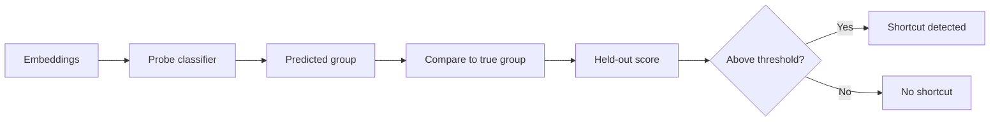

# Probe-based detection

**Probe-based detection** tests whether the group can be predicted from the embedding. If a classifier trained on the embeddings predicts group membership well, the embeddings carry group information.

!!! note "The paper's conditional probe"
    The thresholds on this page belong to the interactive `SKLearnProbe` and decide nothing in the paper. The paper's primary test is the conditional probe in `shortcut_detect.audit.conditional_audit`: an L2 logistic regression (`C=1.0`) predicts the attribute from the standardised embedding concatenated with the task label; the score is the out-of-fold AUROC of 5-fold cross-validation stratified on attribute and task and grouped by patient; the p-value comes from permuting the attribute within task-label strata, between patients where patient ids are given (K=500 in the clinical audits). Conditioning on the task label is what keeps an embedding that encodes only the task from being flagged when attribute and task are correlated.

## How it works

1. **Train a classifier** on the embeddings to predict the group
2. **Score it** on held-out rows (or by cross-validation)
3. **Flag** a shortcut when the score exceeds a threshold



## Basic usage

### SKLearnProbe

```python
from sklearn.linear_model import LogisticRegression
from shortcut_detect import SKLearnProbe

probe = SKLearnProbe(
    LogisticRegression(max_iter=1000),
    metric="accuracy",      # or "f1" (default), "precision", "recall", "roc_auc"
    evaluation="holdout",   # or "cv", "train"
    test_size=0.2,
    threshold=0.70,
    random_state=42,
)
probe.fit(embeddings, group_labels)   # the probe splits the data itself

print(f"held-out accuracy: {probe.metric_value_:.2%}")
print(f"flagged: {probe.shortcut_detected_} (risk {probe.get_report()['risk_level']})")
```

`fit` takes the whole dataset and does the split or the cross-validation internally. With `estimator=None` the probe is a standardised logistic regression. The risk level is `high` when the metric reaches `max(threshold, 0.85)`, `moderate` when it reaches `threshold`, and `low` below.

### TorchProbe

For GPU training or a custom architecture:

```python
import torch.nn as nn
from shortcut_detect import TorchProbe

class MLPProbe(nn.Module):
    def __init__(self, input_dim, n_classes):
        super().__init__()
        self.layers = nn.Sequential(
            nn.Linear(input_dim, 256),
            nn.ReLU(),
            nn.Dropout(0.3),
            nn.Linear(256, n_classes),
        )

    def forward(self, x):
        return self.layers(x)

probe = TorchProbe(
    model=MLPProbe(512, 3),        # 512-dim embeddings, 3 groups
    loss_fn=nn.CrossEntropyLoss(),
    device="cuda",                 # None picks cuda when available, else cpu
    epochs=50,
    optimizer_kwargs={"lr": 1e-3},
)
probe.fit(embeddings, group_labels)
print(probe.metric_value_, probe.shortcut_detected_)
```

### Advanced: externalize the DataLoader

`TorchProbe` builds its own loaders by default; a loader factory and per-stage overrides replace them:

```python
import torch
import torch.nn as nn
from torch.utils.data import DataLoader

def probe_loader_factory(req):
    # req.stage in {"train", "val", "eval", "predict"}
    return DataLoader(
        req.dataset,
        batch_size=req.batch_size,
        shuffle=req.shuffle,
        num_workers=req.num_workers,
        pin_memory=req.pin_memory,
        drop_last=req.drop_last,
        **req.extra_kwargs,
    )

probe = TorchProbe(
    model=MLPProbe(512, 3),
    loss_fn=nn.CrossEntropyLoss(),
    loader_factory=probe_loader_factory,
    stage_loader_overrides={"predict": {"batch_size": 16}},
)
```

### Advanced: file-backed datasets

`fit_dataset(...)` trains from a map-style or iterable dataset without loading everything into RAM:

```python
import torch
import torch.nn as nn
from shortcut_detect.probes import TorchProbe

class EmbeddingDataset(torch.utils.data.Dataset):
    def __init__(self, rows):
        self.rows = rows  # file index / metadata

    def __len__(self):
        return len(self.rows)

    def __getitem__(self, idx):
        x = load_embedding_from_file(self.rows[idx])   # shape (d,)
        y = load_group_label(self.rows[idx])           # int class id
        return {"embeddings": x, "labels": y}

probe = TorchProbe(
    model=nn.Linear(512, 2),
    loss_fn=nn.CrossEntropyLoss(),
    metric="accuracy",
    device="cpu",
)
probe.fit_dataset(EmbeddingDataset(index_rows))
```

## Parameters

### SKLearnProbe

| Parameter | Type | Default | Description |
|-----------|------|---------|-------------|
| `estimator` | sklearn estimator | standardised `LogisticRegression` | Any estimator with `fit` and `predict` |
| `metric` | str | `"f1"` | `"accuracy"`, `"f1"`, `"precision"`, `"recall"` or `"roc_auc"` |
| `threshold` | float | 0.70 | Shortcut when the metric exceeds it |
| `average` | str | `"macro"` | Averaging for multiclass f1, precision, recall |
| `evaluation` | str | `"holdout"` | `"holdout"`, `"cv"` or `"train"` |
| `test_size` | float | 0.2 | Held-out share for `"holdout"` |
| `cv_folds` | int | 5 | Folds for `"cv"` |
| `random_state` | int | 0 | Seed for the split |

### TorchProbe

| Parameter | Type | Default | Description |
|-----------|------|---------|-------------|
| `model` | nn.Module | required | The probe network |
| `loss_fn` | callable | required | For example `nn.CrossEntropyLoss()` |
| `optimizer_class` | class | `torch.optim.Adam` | Optimizer |
| `optimizer_kwargs` | dict | `{"lr": 1e-3}` | Optimizer arguments |
| `device` | str or None | None | `"cuda"` when available, else `"cpu"` |
| `metric` | str | `"accuracy"` | Score reported in `metric_value_` |
| `threshold` | float | 0.70 | Shortcut when the metric exceeds it |
| `test_size` | float | 0.2 | Held-out share |
| `epochs` | int | 10 | Training epochs |
| `batch_size` | int | 128 | Batch size |
| `early_stopping` | int or None | None | Patience in epochs |
| `loader_factory` | callable or None | None | Builds loaders by stage |
| `stage_loader_overrides` | dict or None | None | Per-stage DataLoader kwargs |

## Outputs

| Attribute | Type | Description |
|-----------|------|-------------|
| `metric_value_` | float | The held-out (or cross-validated) score |
| `shortcut_detected_` | bool | `metric_value_ > threshold` |
| `estimator_` | estimator | The fitted sklearn estimator (`SKLearnProbe`) |
| `y_true_eval_`, `y_pred_eval_` | ndarray | Held-out labels and predictions (`SKLearnProbe`, holdout and train evaluation) |
| `results_` | dict | Standard detector schema; `results_["report"]` holds `fold_scores`, `mean_score` and `std_score` under `evaluation="cv"` |

`predict(X)` returns labels from the fitted estimator or network.

### Interpretation

| Score | Risk level |
|-------|------------|
| below `threshold` (0.70) | low |
| `threshold` to 0.85 | moderate |
| 0.85 and above | high |

!!! warning "Baseline correction"
    With imbalanced groups, compare the score with the majority-class rate:
    ```python
    baseline = max(np.bincount(probe.y_true_eval_)) / len(probe.y_true_eval_)
    corrected = (probe.metric_value_ - baseline) / (1 - baseline)
    ```

## Classifier comparison

Different classifiers pick up different shortcuts:

```python
from sklearn.linear_model import LogisticRegression
from sklearn.svm import SVC
from sklearn.ensemble import RandomForestClassifier

classifiers = {
    "Logistic Regression": LogisticRegression(max_iter=1000),
    "Linear SVM": SVC(kernel="linear"),
    "RBF SVM": SVC(kernel="rbf"),
    "Random Forest": RandomForestClassifier(n_estimators=100),
}

for name, clf in classifiers.items():
    probe = SKLearnProbe(clf, metric="accuracy", evaluation="holdout", random_state=42)
    probe.fit(embeddings, group_labels)
    print(f"{name}: {probe.metric_value_:.2%}")
```

| Classifier | Best for |
|------------|----------|
| Logistic Regression | Linear shortcuts |
| Linear SVM | Margin-based linear separation |
| RBF SVM | Non-linear shortcuts |
| Random Forest | Complex, non-linear patterns |

## Feature importance

Which dimensions the probe leans on:

```python
import numpy as np
from sklearn.linear_model import LogisticRegression

probe = SKLearnProbe(LogisticRegression(max_iter=1000), metric="accuracy")
probe.fit(embeddings, group_labels)

importance = np.abs(probe.estimator_.coef_).mean(axis=0)
top_features = np.argsort(importance)[-10:]
print("Top 10 shortcut dimensions:", top_features)
```

With the default estimator (a pipeline), the classifier sits at `probe.estimator_.named_steps["clf"]`.

## Cross-validation

For a score that depends less on one split:

```python
probe = SKLearnProbe(LogisticRegression(max_iter=1000), metric="accuracy",
                     evaluation="cv", cv_folds=5, random_state=42)
probe.fit(embeddings, group_labels)

report = probe.get_report()["report"]
print(f"CV accuracy: {report['mean_score']:.2%} (SD {report['std_score']:.2%})")
print(report["fold_scores"])
```

## When to use probes

**Use probes when:**

- You want a direct measure of how recoverable the group is
- You need feature importance
- Your embeddings have many dimensions
- You want to compare linear and non-linear shortcuts

**Don't use probes when:**

- You have very few samples (< 100)
- Groups are highly imbalanced (correct for the baseline first)
- You want an unsupervised analysis

## Theory

If the group $G$ can be predicted from the embedding $E$ better than chance, the two share information: $I(E; G) > 0$. A probe's held-out score is one practical reading of that; the paper's audit turns the same idea into a calibrated test by comparing the probe's AUROC with its value under permuted attributes.

## See also

- [Statistical testing](statistical.md): dimension-level analysis
- [API reference](../api/probes.md): full API documentation
- [Overview](overview.md): compare all methods
