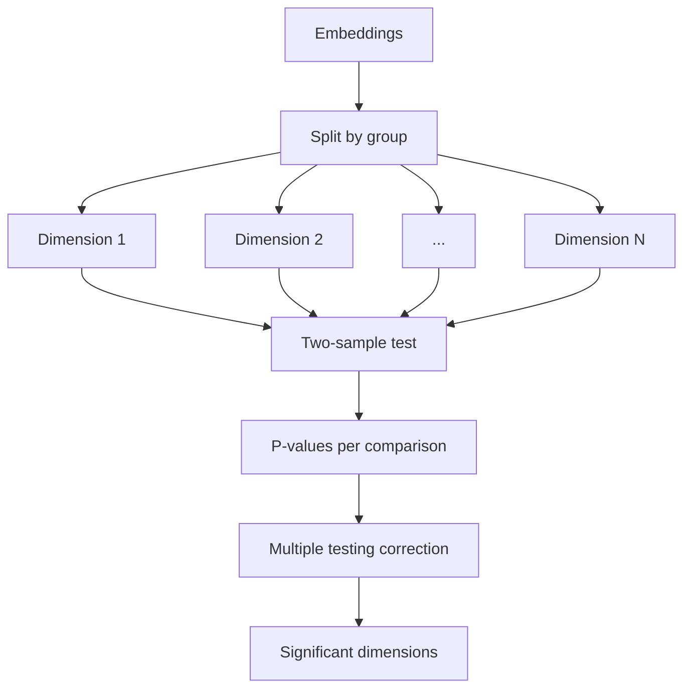

# Statistical testing

**Statistical testing** finds the embedding dimensions along which the groups differ. It is the one method that names specific dimensions.

## How it works

1. For every dimension, `GroupDiffTest` runs a two-sample test between the groups (Mann-Whitney U in the pipeline; any SciPy-style test works)
2. With two groups there is one comparison; with three or more, every one-vs-one and one-vs-rest comparison
3. `apply_correction` adjusts the p-values of each comparison for multiple testing (Benjamini-Hochberg by default) and lists the dimensions that stay significant
4. A comparison with at least one significant dimension sets `shortcut_detected_`



## Basic usage

```python
from scipy.stats import mannwhitneyu
from shortcut_detect import GroupDiffTest

test = GroupDiffTest(test=mannwhitneyu)
test.fit(embeddings, group_labels)

raw = test.get_pvalues()   # {comparison: array of p-values, one per dimension}
corrected = test.apply_correction(alpha=0.05, method="fdr_bh", verbose=False)

for comparison, significant in corrected["significant_features"].items():
    print(f"{comparison}: {len(significant or [])} significant dimensions")
print(test.shortcut_detected_)
```

## Parameters

`GroupDiffTest(test, **test_kwargs)`, an alias of `FeatureGroupDiffTest`:

| Parameter | Type | Description |
|-----------|------|-------------|
| `test` | callable | Called as `test(x1, x2, **test_kwargs)` on the two groups' values of one dimension. Must return a p-value, or a tuple whose second element is the p-value (SciPy's convention) |
| `**test_kwargs` | | Forwarded to `test`, for example `alternative="two-sided"` |

The significance level and the correction are arguments of `apply_threshold` and `apply_correction`, not of the constructor.

## Available tests

Each call sees exactly two samples (one dimension, two groups), so any SciPy two-sample test fits:

```python
from scipy.stats import mannwhitneyu, ttest_ind, ks_2samp

test = GroupDiffTest(test=mannwhitneyu)   # rank-based, no normality assumption
test = GroupDiffTest(test=ttest_ind)      # assumes normality
test = GroupDiffTest(test=ks_2samp)       # any difference in distribution
test = GroupDiffTest(test=mannwhitneyu, alternative="greater")  # kwargs reach the test
```

With three or more groups the class runs every one-vs-one and one-vs-rest comparison with the same two-sample test; there is no need for a k-sample test.

## Multiple testing correction

```python
test.fit(embeddings, group_labels)

bh = test.apply_correction(alpha=0.05, method="fdr_bh", verbose=False)        # Benjamini-Hochberg
bonferroni = test.apply_correction(alpha=0.05, method="bonferroni", verbose=False)
holm = test.apply_correction(alpha=0.05, method="holm", verbose=False)
by = test.apply_correction(alpha=0.05, method="fdr_by", verbose=False)        # Benjamini-Yekutieli

uncorrected = test.apply_threshold(alpha=0.05, verbose=False)  # raw p < alpha, not recommended
```

| Method | Controls | Strictness |
|--------|----------|------------|
| `bonferroni` | family-wise error rate | strictest |
| `holm` | family-wise error rate | strict |
| `fdr_bh` | false discovery rate | moderate (default in the pipeline) |
| `fdr_by` | false discovery rate under dependence | between `holm` and `fdr_bh` |

Each `apply_correction` call returns a dict with `significant_features`, `corrected_pvalues` and `rejected` (all keyed by comparison), plus `method` and `alpha`, and updates `shortcut_detected_` and `results_`.

## Outputs

| Name | Type | Description |
|------|------|-------------|
| `p_values_` | dict | Raw p-values per comparison (array of length `embedding_dim`); also returned by `get_pvalues()` |
| `shortcut_detected_` | bool or None | None after `fit`; set by `apply_threshold` or `apply_correction` |
| `apply_correction(...)["corrected_pvalues"]` | dict | Adjusted p-values per comparison |
| `apply_correction(...)["significant_features"]` | dict | Significant dimension indices per comparison, or `None` when there are none |
| `apply_correction(...)["rejected"]` | dict | Boolean mask per comparison |

The class computes no effect sizes; see [Effect size calculation](#effect-size-calculation) for a few lines that do.

### Interpretation

| % significant dimensions | Reading |
|--------------------------|---------|
| < 5% | Few dimensions carry group information |
| 5-20% | Some dimensions carry it |
| 20-50% | Many dimensions carry it |
| > 50% | Group information is spread through the embedding |

These bands are a reading aid, not a decision rule. The paper's audit uses the fraction of BH-significant dimensions within task strata as one secondary statistic and calibrates it against a permutation null; see the [Audit API](../api/audit.md).

## Visualization

### Volcano plot

```python
import numpy as np
import matplotlib.pyplot as plt

comparison = next(iter(corrected["corrected_pvalues"]))
q = corrected["corrected_pvalues"][comparison]
significant = set(corrected["significant_features"][comparison] or [])

# Cohen's d per dimension, computed by hand
g0, g1 = np.unique(group_labels)[:2]
x0, x1 = embeddings[group_labels == g0], embeddings[group_labels == g1]
pooled = np.sqrt((x0.var(axis=0, ddof=1) + x1.var(axis=0, ddof=1)) / 2)
d = (x1.mean(axis=0) - x0.mean(axis=0)) / pooled

fig, ax = plt.subplots(figsize=(10, 6))
colors = ["red" if i in significant else "gray" for i in range(len(d))]
ax.scatter(d, -np.log10(q + 1e-300), c=colors, alpha=0.5)
ax.axhline(-np.log10(0.05), color="blue", linestyle="--", label="q = 0.05")
ax.set_xlabel("Cohen's d")
ax.set_ylabel("-log10(BH-adjusted p)")
ax.legend()
plt.tight_layout()
plt.savefig("volcano_plot.png")
```

### Most significant dimensions

```python
order = np.argsort(q)[:20]

fig, ax = plt.subplots(figsize=(10, 6))
ax.barh(range(len(order)), -np.log10(q[order] + 1e-300))
ax.set_yticks(range(len(order)))
ax.set_yticklabels([f"dim {i}" for i in order])
ax.set_xlabel("-log10(BH-adjusted p)")
plt.tight_layout()
plt.savefig("significant_features.png")
```

## Effect size calculation

P-values say whether a dimension differs; an effect size says by how much:

```python
def cohens_d(group1, group2):
    n1, n2 = len(group1), len(group2)
    var1, var2 = group1.var(ddof=1), group2.var(ddof=1)
    pooled_std = np.sqrt(((n1 - 1) * var1 + (n2 - 1) * var2) / (n1 + n2 - 2))
    return (group1.mean() - group2.mean()) / pooled_std

effect_sizes = np.array([
    cohens_d(embeddings[group_labels == g0, dim], embeddings[group_labels == g1, dim])
    for dim in range(embeddings.shape[1])
])
```

| Effect size (|d|) | Interpretation |
|-------------------|----------------|
| < 0.2 | Small |
| 0.2 - 0.5 | Medium |
| 0.5 - 0.8 | Large |
| > 0.8 | Very large |

## Several groups

```python
from scipy.stats import mannwhitneyu

test = GroupDiffTest(test=mannwhitneyu)
test.fit(embeddings, group_labels)   # labels 0, 1, 2, ...
corrected = test.apply_correction(alpha=0.05, method="fdr_bh", verbose=False)

for comparison, significant in corrected["significant_features"].items():
    # keys such as 0_vs_1, 0_vs_2, 1_vs_2, 0_vs_rest, 1_vs_rest, 2_vs_rest
    print(f"{comparison}: {len(significant or [])} significant dimensions")
```

## When to use statistical testing

**Use statistical testing when:**

- You want to identify specific biased dimensions
- You need interpretable, dimension-level results
- Your embeddings are high-dimensional

**Don't use statistical testing when:**

- Biases are non-linear or interaction-based
- You have very few samples per group
- You only care about aggregate shortcut presence

## Theory

For each dimension $d$ the null hypothesis is that its distribution is the same across groups, and $p_d$ is the probability of the observed difference under that null.

Multiple testing correction controls the false discovery rate:

$$\text{FDR} = E\left[\frac{\text{False Positives}}{\text{Total Rejections}}\right] \leq \alpha$$

## See also

- [HBAC clustering](hbac.md): aggregate shortcut detection
- [API reference](../api/statistical.md): full API documentation
- [Overview](overview.md): compare all methods
